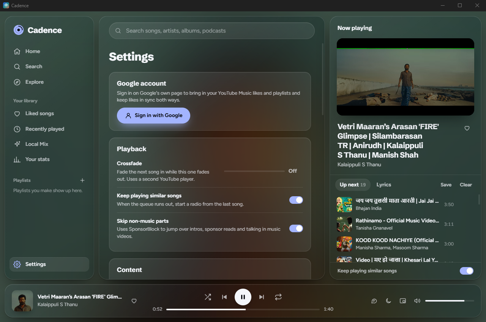
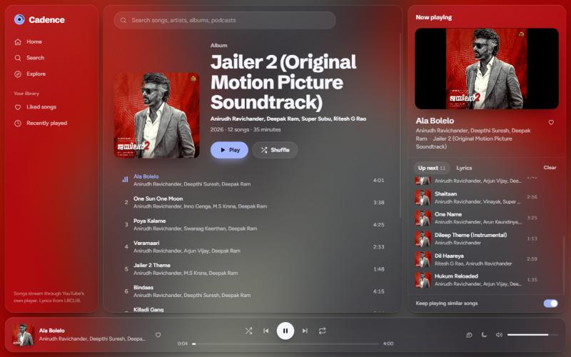
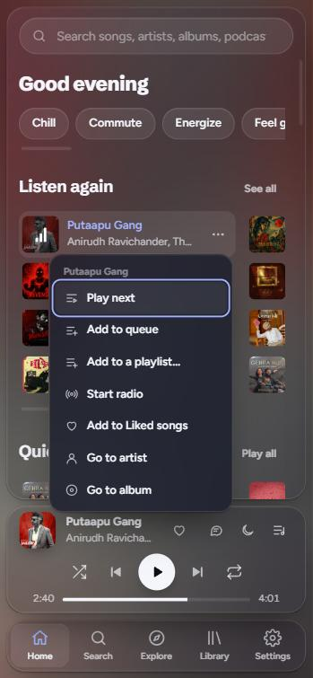

# Cadence

A YouTube Music player with a frosted-glass interface whose colours come from the song that's
playing. It runs as a web app, on Vercel, on Android and on Windows, all from one UI.

> **Beta (v0.0.1).** Expect rough edges. Google sign-in in the apps hasn't been tried on many
> accounts yet; please open an issue if something breaks.



| | |
|---|---|
|  |  |

On the web, every song plays through YouTube's own embedded player. The Android and Windows apps
stream each song's highest-bitrate audio directly (nothing is saved to your device), which is what
lets them keep playing with the screen off, show the real format and bitrate, and offer an
equalizer. Nothing is downloaded or ripped. Your
library (likes, history, playlists, settings) is stored on your device, never on a server. Use
**Settings › Save a backup** to keep a copy.

## Download

From the [v0.0.1-beta release](../../releases/tag/v0.0.1-beta):

- **Android** (8.0 or newer, 64-bit ARM): `Cadence-0.0.1-beta-arm64.apk`. Allow installs from
  unknown sources when Android asks. It's signed with the standard Android debug key, so a later
  release signed with a proper key will need an uninstall first.
- **Windows** (10 or 11, x64): `Cadence_0.0.1_x64-setup.exe`. It isn't code-signed, so SmartScreen
  may say "Windows protected your PC": choose **More info › Run anyway**.

Or run the web version yourself (below).

## Features

- Search songs, videos, albums, artists, playlists and podcasts, with live suggestions and recent searches
- Home feed, moods & genres (with a one-tap **Mix** that blends several playlists), artist and album pages
- Queue with play next / add to queue, shuffle, repeat (off / all / one), and an endless radio when it runs out
- **Crossfade** (1–12 s) using two players (web and Windows)
- **Sound** (Android and Windows): always the best audio stream YouTube offers, its format and bitrate shown in *Now playing*, volume evening, a 5-band equalizer with presets, and skip silence on Android
- **Synced lyrics** from LRCLIB in the side panel and full screen; tap a line to jump there
- **SponsorBlock** skipping of non-music parts in music videos (looked up by hash prefix, so it never sees the exact video)
- Sleep timer (15–90 minutes or end of song)
- Your own playlists: create, rename, reorder, delete, save the queue as a playlist
- Liked songs, recently played
- **Local Mix**: For you, This time of day, Rediscover, plus Mix radio, built only from your own history
- **Your stats**: minutes, plays, songs, days, longest streak, listening by hour, top songs, artists and albums; a yearly recap under *This year*
- **Google sign-in**: your YouTube Music likes and playlists, with likes synced both ways
- Region and language for YouTube Music, remappable keyboard shortcuts, backup and restore
- Floating mini player (Chrome/Edge), restored queue and position after a restart
- Songs whose owners block playback outside YouTube are swapped for another upload, or skipped
- The apps fall back to YouTube's embedded player for a song that can't be streamed directly, so music never just stops

## Where it runs

| Where | How the music API runs | Start it |
|---|---|---|
| Your computer | Python (`server.py` + `core.py`, ytmusicapi) | `.venv\Scripts\python server.py --open` |
| Vercel | the same Python app (`server.py`'s WSGI `app` + `core.py`) | `vercel deploy` |
| Android | Rust inside a Tauri 2 app (`src-tauri/`, rustypipe) | install the APK |
| Windows | the same Rust core and Tauri app | run the installer |

## Google sign-in

Signing in brings your YouTube Music account into Cadence: your liked songs and playlists, and
likes that sync both ways (a heart here likes the song on YouTube Music).

### In the Android and Windows apps: sign in directly

No setup needed. **Settings › Google account › Sign in with Google** opens Google's own sign-in
page inside the app, the way apps like InnerTube and Metrolist do it: a screen on Android, a
private (InPrivate) window on Windows. When it lands on YouTube Music signed in, the session
cookies go to the Rust core and the page's own copy is wiped (YouTube rotates cookies whenever a
browser keeps using the same session, which would break the copy the app keeps).

- The session is a full Google sign-in for your account, kept in the app's private storage
  (rustypipe's cache plus `google-cookie.txt`). **Sign out** deletes both.
- Liked songs and saved playlists come through rustypipe; likes go back to YouTube Music, and your
  account name comes from YouTube Music's own web API.
- Not in the apps yet: adding plays to your YouTube Music history, and a personal Home feed.
- Google sometimes refuses sign-in inside apps ("This browser or app may not be secure"). If that
  happens, Cadence can't work around it; use the web version's device sign-in instead.

### On the web: device sign-in (one-time setup)

A website can't read Google's cookies or show Google's sign-in page inside itself (browsers block
both, which is what keeps other sites from taking over your account). So the web version uses
Google's device sign-in: Cadence shows a code, you approve it on google.com/device, and Cadence
keeps a revocable token on your device. It never sees your password. **Sign out** also revokes the
token on Google's side.

That needs an OAuth client you own, created once by whoever runs the server (about 5 minutes):

1. Open https://console.cloud.google.com, click the project picker in the top bar, then **New project**. Name it `Cadence` and create it.
2. **APIs & Services › Library**: search for **YouTube Data API v3** and click **Enable**.
3. **Google Auth Platform › Get started** (called "OAuth consent screen" in older consoles): app name `Cadence`, your email as support contact, audience **External**, then create.
4. **Audience › Test users › Add users**: add the Google accounts that will sign in.
5. **Clients › Create client**: application type **TVs and Limited Input devices**, name `Cadence`, create. Copy the **Client ID** and **Client secret** (or download the JSON).
6. Give them to Cadence:
   - **On your computer:** save the downloaded JSON as `oauth-client.json` in this folder, or set the
     `CADENCE_GOOGLE_CLIENT_ID` and `CADENCE_GOOGLE_CLIENT_SECRET` environment variables, then restart `server.py`.
   - **On Vercel:** Project › Settings › Environment Variables, add the same two variables, then redeploy.
7. In Cadence: **Settings › Google account › Sign in with Google**.

While the client stays in Google's **Testing** mode, only the test users you added can sign in,
and a sign-in lasts 7 days. **Audience › Publish app** removes the 7-day limit; Google then shows
an "unverified app" warning on the approval page, which you can click through for your own client.

The access token travels to the music API in an `X-Cadence-Token` header (never the URL), answers
for a signed-in listener are never cached (not in memory, not at Vercel's edge), and the refresh
token only leaves your device to be refreshed or revoked.

## Run it on your computer

```powershell
py -3.11 -m venv .venv
.venv\Scripts\python -m pip install -r requirements.txt
.venv\Scripts\python server.py --open
```

It serves `public/` and the API on http://127.0.0.1:5288.

## Deploy to Vercel

Vercel serves `public/` as static files and runs the WSGI `app` in `server.py` for every `/api/*` call. Answers that are the same for everyone (search, albums, lyrics…) are
edge-cached for 10 minutes.

```powershell
vercel login
vercel deploy          # preview URL
vercel deploy --prod   # production URL
```

YouTube Music localises results by the server's location, so set **Settings › Region** in the app
to your country after deploying.

## Build the Windows app

Needs Rust (MSVC toolchain), the Visual Studio C++ build tools, and Node.

```powershell
npm install
$env:RUSTUP_TOOLCHAIN = "stable-x86_64-pc-windows-msvc"
npx tauri build --bundles nsis
```

The installer lands in `src-tauri\target\release\bundle\nsis\`. macOS and Linux builds have to be
made on those systems.

## Build the Android app

Needs JDK 17+, the Android SDK with NDK 27, Rust with the Android targets, and Node.

```powershell
npm install
rustup target add aarch64-linux-android armv7-linux-androideabi i686-linux-android x86_64-linux-android
$env:JAVA_HOME = "<path to your JDK>"
$env:ANDROID_HOME = "$env:LOCALAPPDATA\Android\Sdk"
$env:NDK_HOME = "$env:ANDROID_HOME\ndk\27.2.12479018"
npx tauri android build --apk --target aarch64
```

Tauri links the Rust library into the Android project with a symlink, which Windows only allows
with **Developer Mode** on (Settings › System › For developers). Without it, the build stops at
"Creation symbolic link is not allowed". Either turn Developer Mode on, or let the Rust build
finish, then copy `src-tauri\target\aarch64-linux-android\release\libcadence_lib.so` into
`src-tauri\gen\android\app\src\main\jniLibs\arm64-v8a\` and run
`.\gradlew.bat assembleArm64Release -x rustBuildArm64Release` in `src-tauri\gen\android`.

The release APK comes out unsigned; sign it (zipalign, then apksigner) before installing.

The Rust API is tested live with `cargo test --test smoke -- --nocapture` in `src-tauri/`, and its
helpers (including the local audio server's ranges, chunking and link refresh) with
`cargo test --lib`. The audio-streaming smoke test needs a connection whose IP stays the same
between youtube.com and googlevideo.com: `cargo test --test smoke songs_stream -- --ignored --nocapture`.

The page's players (desktop `<audio>`, the Android player's page side, the embed fallback, and the
whole page in desktop mode) are tested in headless Chromium with `tests/player/run.sh`; it needs
Python 3, Node and Playwright (`npm install --no-save playwright`).

## Known limits

- **Background playback:** works in the Android app: the audio plays in a foreground media service
  (ExoPlayer) with a notification and lock-screen controls, and it queues the next few songs
  itself, so songs change while the screen is off. The web version uses YouTube's embedded player,
  which mobile browsers pause when the page is hidden; a browser can't fetch YouTube audio itself
  (cross-origin rules, and stream links are tied to the IP that asked for them), so the web
  version would need a server that fetches and relays the audio. It doesn't have one.
- **Audio quality:** the Android and Windows apps pick the highest-bitrate stream YouTube offers
  (up to about 256 kbps Opus/AAC). YouTube has no lossless audio, so FLAC isn't possible. The
  embedded player has no audio-quality setting (`setPlaybackQuality` is deprecated and does
  nothing), so the web version, and any song that falls back to the embed, use YouTube's default.
- **Direct streams rely on YouTube's iOS client**, which rustypipe can still use without a PO
  token. If YouTube changes that, songs fall back to the embedded player (and pause in the
  background on Android) until rustypipe catches up.
- **The apps have no podcasts**, and build Home from charts and new releases (even when signed in),
  because rustypipe has no podcast or personalised home endpoints.
- **Not available yet:** offline downloads, crossfade on Android, and the equalizer and volume
  evening on the web.
- **Backups on Android:** *Save a backup* uses a browser download, which the Android webview may
  ignore. Restore works.

## Layout

```
public/          the UI shared by every version (index.html, app.css, store.js, engine.js, app.js, features.js)
core.py          stateless music API (YouTube Music, LRCLIB, SponsorBlock, Google device sign-in)
server.py        local server, plus the WSGI app Vercel runs: public/ + core.py
src-tauri/       Android and Windows app; src/music.rs and src/extras.rs are the Rust port of core.py,
                 src/stream.rs is the local audio server that players read songs from
src-tauri/gen/android/app/src/main/java/app/cadence/player/   in-app Google sign-in, the audio player and its
                 background service (Kotlin)
tests/player/    browser tests of the page's players (run.sh)
src-tauri/vendor/rquickjs-sys   patched dependency that adds Android bindings (see its CADENCE-PATCH.md)
```

## Licence

GPL-3.0-or-later (see `LICENSE`): the apps link rustypipe, which is GPL-3.0. The vendored
`rquickjs-sys` keeps its own MIT licence.

Cadence isn't affiliated with YouTube or Google. Songs play through YouTube's official embedded
player, and lyrics come from LRCLIB.
